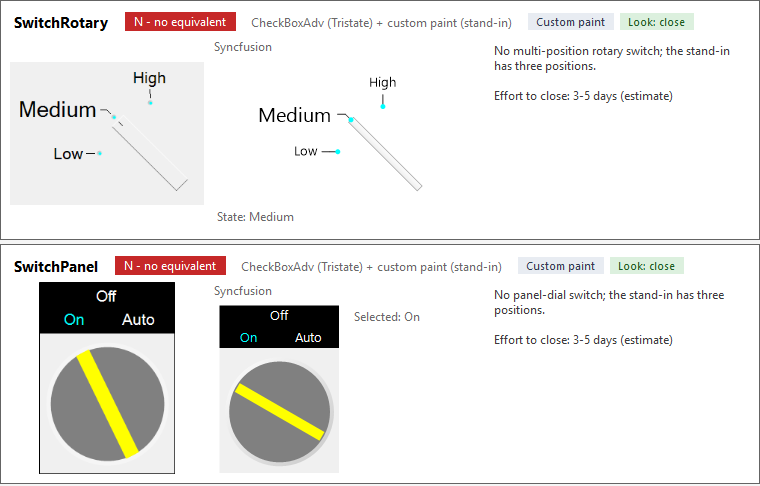

# iocomp-winforms-equivalents-controls

This sample shows Syncfusion WinForms equivalents for the 56 iocomp .NET WinForms controls. Each control has a card with the iocomp reference image, a live Syncfusion (or custom) version next to it, and notes on how close the match is.



## Projects

| Project | Description |
|---|---|
| `src/PocApp` | WinForms sample app. It has one tab per category (Plot, Gauges, Digital, Clocks, Inputs, Switches, Leds, Process) and a **Gap register** tab that lists each iocomp control with its Syncfusion equivalent, rating and gaps. |
| `src/HmiControls` | Small custom controls for iocomp features that have no Syncfusion equivalent: `SwitchQuad`, `Led`, `LedArrow`, `MatrixLeds`, `Odometer`, `Pipe`, `PipeJoint`, `Valve`, `Motor`, `RotationDisplay`. |
| `iocomp-dotnet-images` | iocomp reference images, shown beside each control. |

### Switches with no equivalent, built on Syncfusion controls

Some iocomp switches have no Syncfusion equivalent but are built on a Syncfusion control with custom painting (in `src/PocApp/Cards`). The Syncfusion control keeps the state, events and keyboard handling. These are rated "N - no equivalent" and labelled "stand-in" in the gap register.

| iocomp control | Built on | Positions |
|---|---|---|
| SwitchRocker | `ToggleButton` + `IToggleButtonRenderer` | 2 |
| SwitchLever | `CheckBoxAdv` + custom paint | 2 |
| SwitchRocker3Way, SwitchRotary, SwitchPanel, SwitchSlider | `CheckBoxAdv` (Tristate) + custom paint, sharing the `ThreePositionBox` base | 3 |

A tristate `CheckBoxAdv` holds three states, so these four switches are limited to three positions (iocomp allows any number). `CheckState` maps to position 0, 1 and 2 as Unchecked, Indeterminate and Checked. SwitchQuad has four positions, so it stays a custom control in `HmiControls`.

## Requirements

- Windows
- .NET SDK 10.0.404 or a later patch (see `global.json`)
- Syncfusion Essential Studio for WinForms 35.2.12 (Chart, Gauge, Tools, Diagram), restored from NuGet

## Build and run

```cmd
dotnet build IocompPoc.sln -c Release
dotnet run --project src\PocApp -c Release
```

To register a Syncfusion license key, set the `SYNCFUSION_LICENSE_KEY` environment variable before running. Without a key, Syncfusion shows its license notice.

## Troubleshooting

- **A "Syncfusion License" window opens with the app.** No license key is registered. Close the window to continue, or set `SYNCFUSION_LICENSE_KEY` (see above) and start the app again.
- **A command-line run never finishes.** `--snapshots` and `--compare` open the main window, so without a key the license notice opens too and waits to be closed. Set the key first, or close the notice when it appears. (`--selftest` and `--export` don't open the main window and finish on their own.)
- **Package restore fails.** `nuget.config` uses nuget.org only, so check that nuget.org can be reached from your network.

## Command-line options

| Option | Purpose |
|---|---|
| `--selftest <report.md>` | Runs scripted mouse and keyboard checks on the interactive controls on a hidden form, writes a Markdown report, and exits with code 0 if every check passes. |
| `--snapshots <dir>` | Saves each tab as a PNG, using fixed signal values so the output is the same every run. |
| `--compare <baselineDir> <currentDir>` | Saves new snapshots to `currentDir`, compares them with `baselineDir`, and writes `COMPARE.md`. |
| `--export <dir>` | Writes the gap register as `GAP_REGISTER_INTERNAL.md` and `MIGRATION_SUMMARY_CUSTOMER.md`. |
